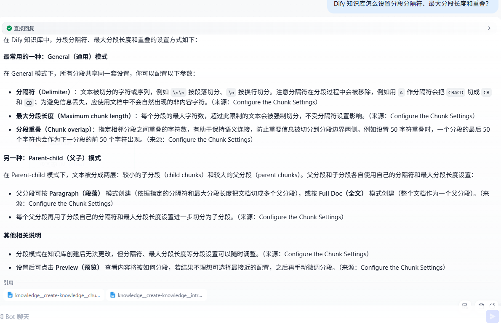

# Dify Docs RAG Assistant


基于 Dify + DeepSeek + BGE-M3 的跨语言文档问答助手：中文提问，检索英文 Dify 官方文档，输出中文答案和引用。


## 30 秒版本


- 语料：Dify 官方文档 68 篇，CC BY 4.0

- 检索：Parent-child Full Doc + BGE-M3 + BGE Reranker v2-m3

- 生成：DeepSeek，中文回答 + 来源引用 + 无答案拒答

- 评测：12 条自建评测集，回答 20/20，引用 19/20，拒答 2/2


## 效果展示





<sub>图：中文提问“怎么设置分段参数”，回答包含 Delimiter、Maximum chunk length、Chunk overlap，并引用 Configure the Chunk Settings。</sub>


示例问题：


```text

Dify 知识库怎么设置分段分隔符、最大分段长度和重叠？

```
## 架构


数据管线：


关键设计：

1. **Chatflow 而不是纯 Agent**：流程固定，可控、可调试、成本低。
2. **Query Rewrite**：中文问题改写成英文检索 query，并扩展 delimiter、maximum chunk length、chunk overlap 等术语。
3. **Parent-child Full Doc**：child chunk 负责匹配，parent 返回整篇文档，避免答案跨 chunk 丢失。
4. **严格评测**：区分回答正确率和引用正确率，不把“答对”当成“引对”。

## 数据与知识库

- 来源：https://github.com/langgenius/dify-docs
- License：CC BY 4.0
- 快照：2026-10-31
- 范围：`en/cloud/use-dify/` 下 6 个目录，共 68 篇

数据处理：

```text
MDX → 去 import/JSX 组件 → 保留标题/表格/代码块 → Markdown
```

知识库配置：

| 配置 | 值 |
|---|---|
| Chunk mode | Parent-child / Full Doc |
| Child separator | `## ` |
| Child max length | 500 |
| Child overlap | 1 |
| Embedding | BAAI/bge-m3 |
| Rerank | BAAI/bge-reranker-v2-m3 |
| TopK | 5 |
| Score threshold | off |

## 评测

12 条自建评测集：10 道可答题 + 2 道拒答题。

| 指标 | 结果 |
|---|---|
| 回答得分 | 20 / 20 = 100% |
| 引用得分 | 19 / 20 = 95% |
| 拒答 | 2 / 2 = 100% |

说明：

- q05 回答正确，但引用的是 knowledge-pipeline / manage 文档，不是 gold_doc，所以引用 1 分。

## 失败案例与迭代

### v1

- q10“怎么分段？”失败，只引用 overview，没有召回 chunking 文档。
- 原因：query rewrite 输出混入 `<think>` 思考块，且 TopK=3 太小。

### v2

- 增加 `清理改写` 代码节点，去掉 `<think>`。
- TopK 从 3 调到 5。
- q10 从 1/2 提升到 2/2。

## 如何运行

### 1. 准备语料

```powershell
git clone --depth 1 --filter=blob:none --sparse https://github.com/langgenius/dify-docs.git vendor/dify-docs
```

或下载 ZIP，复制 `en/cloud/use-dify/` 下 6 个目录到 `data/raw`。

### 2. 清洗

```powershell
py scripts\clean_mdx.py
```

输出：

```text
data/clean/
data/metadata.csv
```

### 3. 建知识库

按上面的知识库配置，在 Dify 中创建 `dify-docs-parent`，上传 `data/upload` 中的文件。

### 4. 建 Chatflow

```text
开始 → 查询改写 → 清理 think → 知识检索 → 回答 LLM → 回答
```

### 5. 跑评测

在 Dify Chatflow 预览中，按 `eval/questions.csv` 逐条输入问题，
把回答和引用记录到 `eval/results_cn.csv`。

## 项目结构

```text
dify-docs/
├── assets/
│   └── demo-1.png
├── data/
│   ├── raw/          # 原始 MDX
│   ├── clean/        # 清洗后的 Markdown
│   ├── upload/       # 拍平后的上传文件
│   └── metadata.csv
├── eval/
│   ├── questions.csv
│   └── results_cn.csv
├── scripts/
│   ├── clean_mdx.py
│   └── build_chunks.py   # 自定义切分实验，未用于最终方案
└── README.md
```

## 局限

- 12 条评测样本较小，不能代表生产准确率
- 语料是 2026-10-31 的快照，文档更新后需要重新索引
- 中文 query 仍依赖 query rewrite，极端模糊问题可能召回不稳定
- 尚未加入鉴权、限流、监控
- 依赖 Dify 和第三方模型/API


## Attribution

Dify documentation is licensed under CC BY 4.0.

- Source: https://github.com/langgenius/dify-docs
- License: https://creativecommons.org/licenses/by/4.0/

